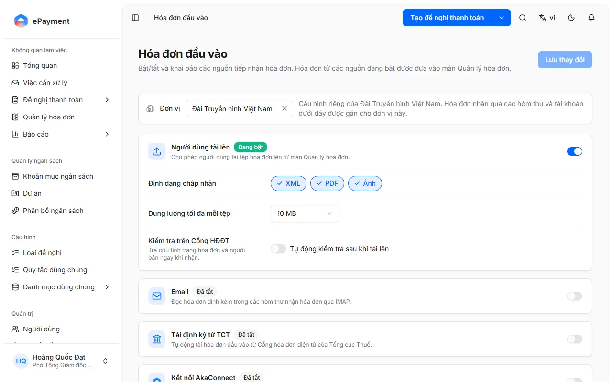

# Quản trị nguồn hóa đơn đầu vào

Trang Quản trị → Hóa đơn đầu vào: bật/tắt nguồn, khai báo hòm thư, tài khoản Cổng HĐĐT, kết nối AkaConnect và AkaPay. Chỉ quản trị viên.

**Quyền cần có:** admin

Có 5 nguồn: **Người dùng tải lên**, **Email** (IMAP), **Tải định kỳ từ TCT** (tải định kỳ từ Cổng HĐĐT của Tổng cục Thuế), **Kết nối AkaConnect** (Gmail, Outlook) và **Tài khoản AkaPay**. Hóa đơn từ các nguồn đang bật được đưa vào trang Quản lý hóa đơn. Riêng nguồn Email: trang lưu được hòm thư và kiểm tra kết nối IMAP, nhưng phần đọc thư và đưa hóa đơn vào danh sách chưa được hỗ trợ (xem [Nhận hóa đơn qua hòm thư email (IMAP)](../connect-mailbox.md)).

Chỉ quản trị viên (và chủ sở hữu tổ chức) mở được trang (**Quản trị** → **Hóa đơn đầu vào**) và lưu thiết lập; người khác không mở và không lưu được (lỗi 403). Trang chỉ dùng trên máy tính, không mở trên điện thoại. Người vận hành không vào được trang này nhưng bấm được **Đồng bộ ngay** trên thẻ nguồn ở Quản lý hóa đơn.

## Lưu ý

- **[Thiết lập nguồn hóa đơn: chung cho tổ chức hay riêng từng đơn vị](../../../reference/invoice-sources/unit-scope.md)**\
  Bật/tắt, định dạng, dung lượng và Kiểm tra trên Cổng HĐĐT áp dụng cho cả tổ chức; tần suất, lịch tải và tài khoản nguồn đặt riêng theo đơn vị.

## Được dùng trong các hướng dẫn

- [Bật/tắt nguồn hóa đơn và lưu thiết lập](../how-to/configure.md) — Ở Quản trị → Hóa đơn đầu vào, chọn phạm vi đơn vị, bật/tắt từng nguồn, chỉnh định dạng, dung lượng, kiểm tra trên Cổng HĐĐT, tần suất rồi bấm Lưu thay đổi.
- [Kết nối hòm thư Gmail/Outlook qua AkaConnect](../how-to/connect-akaconnect.md) — Bật Kết nối AkaConnect, chọn đơn vị, bấm Thêm kết nối và hoàn tất kết nối hòm thư Gmail hoặc Outlook trong cửa sổ AkaConnect bật lên.
- [Kết nối tài khoản AkaPay bằng API key](../how-to/connect-akapay.md) — Bật Tài khoản AkaPay, bấm Thêm tài khoản, dán API key, Tải pipeline, chọn pipeline, chọn trạng thái hóa đơn cần nhận, đặt tên rồi Thêm.
- [Thêm hòm thư nhận hóa đơn qua IMAP](../how-to/connect-mailbox.md) — Chọn đơn vị, bấm Thêm hòm thư ở thẻ Email, nhập địa chỉ, chọn cách đăng nhập (mật khẩu ứng dụng hoặc OAuth), Kiểm tra kết nối rồi Thêm.
- [Tải hóa đơn định kỳ từ Cổng HĐĐT Tổng cục Thuế](../how-to/connect-tax-portal.md) — Bật Tải định kỳ từ TCT, đặt lịch tải, phạm vi, loại hóa đơn, ký hiệu mẫu số; thêm tài khoản Cổng HĐĐT của đơn vị, Kiểm tra kết nối rồi Thêm.
- [Đăng nhập hòm thư bằng OAuth (Microsoft 365, Google, máy chủ khác)](../how-to/mailbox-oauth.md) — Chọn OAuth - Microsoft 365, OAuth - Google hoặc OAuth - máy chủ định danh khác, làm theo Các bước thiết lập, nhập Client ID, Client secret; Google cần Đăng nhập bằng Google.
- [Đăng nhập hòm thư bằng mật khẩu ứng dụng](../how-to/mailbox-password.md) — Trong hộp thoại thêm hòm thư, chọn Cách đăng nhập: Mật khẩu ứng dụng, nhập máy chủ IMAP, cổng, tên đăng nhập và mật khẩu ứng dụng.
