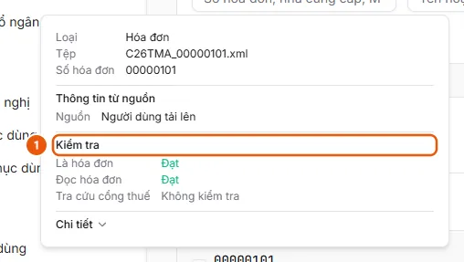
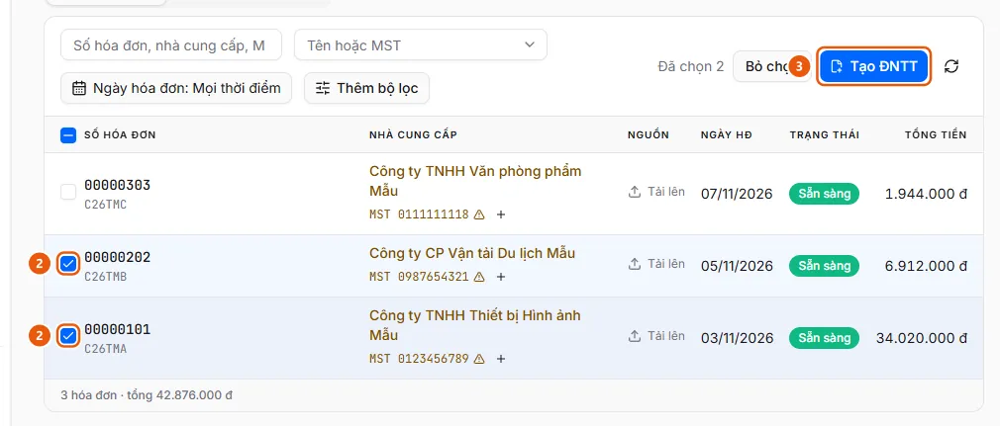
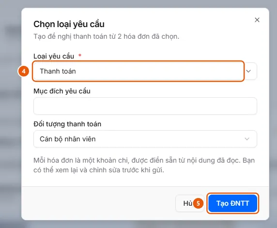

# Tạo ĐNTT từ hóa đơn đã có trong Quản lý hóa đơn

Người dùng muốn chọn nhiều hóa đơn đã đọc sẵn trong Quản lý hóa đơn và lập một đề nghị thanh toán, mỗi hóa đơn là một khoản chi.

**Khi nào sử dụng:**

- Người dùng đang ở Quản lý hóa đơn và muốn thanh toán các hóa đơn chưa tạo ĐNTT.
- Người dùng muốn gom nhiều hóa đơn của nhà cung cấp vào một đề nghị thanh toán.

Đề nghị được tạo thành bản nháp với các khoản chi điền sẵn từ hóa đơn; người dùng xem lại, hoàn tất và nộp như khi [Tạo đề nghị thanh toán](../requests/create-draft.md).

## Các cách thực hiện

- [Chọn hóa đơn và tạo đề nghị thanh toán](how-to/create-request.md) — Tích các hóa đơn Sẵn sàng ở Quản lý hóa đơn, bấm Tạo ĐNTT, chọn Loại yêu cầu và bấm Tạo ĐNTT; mỗi hóa đơn thành một khoản chi trong bản nháp.

## Xem thêm

- [Tạo đề nghị thanh toán](../requests/create-draft.md) — Người dùng muốn lập một đề nghị thanh toán mới và lưu thành bản nháp.

## Được dùng trong các hướng dẫn

- [Tạo đề nghị thanh toán](../requests/create-draft.md) — Người dùng muốn lập một đề nghị thanh toán mới và lưu thành bản nháp.
- [ePayment](../../index.md) — Lập, duyệt và theo dõi đề nghị thanh toán; tiếp nhận hóa đơn đầu vào, đối soát chứng từ và quản lý ngân sách, có trợ lý AI.

## Trước khi bắt đầu

- **[Ai thấy và thao tác được hóa đơn đầu vào](../../reference/invoices/access.md)**\
  Hóa đơn thuộc đơn vị của người tải lên; đơn vị đó và các đơn vị cấp trên thấy được. Quản trị viên và người vận hành thấy mọi đơn vị.
- **[Điều kiện tạo ĐNTT từ hóa đơn](../../reference/invoices/create-request-rules.md)**\
  Chỉ chọn được hóa đơn Sẵn sàng, tối đa 50 hóa đơn mỗi đề nghị, và chỉ với loại đề nghị có dùng hóa đơn.

## Các bước

[Chọn hóa đơn và tạo đề nghị thanh toán](how-to/create-request.md)

1. Kiểm tra [Hóa đơn ở trạng thái Sẵn sàng](../../troubleshooting/invoices/invoice-ready.md).
   Ở Quản lý hóa đơn, cột Trạng thái của hóa đơn hiện "Sẵn sàng" và ô chọn đầu dòng không bị khóa.
   
   Nếu chưa đáp ứng: làm theo [Xem kết quả kiểm tra và xử lý hóa đơn bị dừng](how-to/review-check.md) bên dưới.
2. [Xem kết quả kiểm tra và xử lý hóa đơn bị dừng](how-to/review-check.md) — chỉ khi [Hóa đơn ở trạng thái Sẵn sàng](../../troubleshooting/invoices/invoice-ready.md) chưa được đáp ứng
   1. Ở **Quản lý hóa đơn**, rê chuột lên số hóa đơn để xem mục **Kiểm tra** (1): **Là hóa đơn**, **Đọc hóa đơn**, rồi **Tra cứu cổng thuế** (khi chưa có kết quả, đang tra cứu hoặc dừng ở bước này) hoặc từng dòng kết quả Cổng HĐĐT. Mỗi mục có một kết quả:
      
   2. Bấm vào dòng để mở hóa đơn. Khung kiểm tra ghi lý do dừng: "Không phải hóa đơn", "Không hợp lệ trên cổng thuế", hoặc "Dừng ở bước phân loại tệp / đọc hóa đơn / tra cứu cổng thuế", kèm **Kết quả tra cứu cổng thuế**.
   3. Trạng thái **Gián đoạn**: bấm **Thử lại** để chạy lại bước đã dừng.
   4. Trạng thái **Cần nhập tay** (hoặc Sẵn sàng nhưng đọc sai): sửa các trường ở thẻ **Thông tin hóa đơn**, **Thêm dòng** hàng hóa nếu cần, rồi bấm **Lưu**. Nếu nguồn của hóa đơn bật **Kiểm tra trên Cổng HĐĐT** (và hóa đơn chưa được nguồn xác thực sẵn), hóa đơn chuyển sang **Đang tra cứu** để tra cứu lại; nếu không, chuyển ngay sang **Sẵn sàng**.
   5. Trạng thái **Bị từ chối**, hoặc bạn tin hóa đơn vẫn dùng được: ghi đè theo [Ghi đè kết quả kiểm tra hóa đơn](how-to/overrule-check.md).
3. [Chọn hóa đơn và tạo đề nghị thanh toán](how-to/create-request.md)
   1. Mở **Quản lý hóa đơn**, tab **Chưa tạo ĐNTT**.
   2. Tích ô đầu dòng (2) các hóa đơn **Sẵn sàng** cần thanh toán (tối đa 50), hoặc ô ở tiêu đề để chọn tất cả hóa đơn trên trang. Thanh lệnh hiện "Đã chọn N".
      
   3. Bấm **Tạo ĐNTT** (3). Hộp thoại **Chọn loại yêu cầu** mở ra.
   4. Chọn **Loại yêu cầu** (4); điền các trường tổng quan mà loại đó hỏi (ví dụ mục đích yêu cầu, đối tượng thanh toán).
      
   5. Bấm **Tạo ĐNTT** (5). Hệ thống tạo đề nghị nháp (có số chứng từ) và mở **Quy trình tạo** ở bước **Tổng quan** với các trường vừa điền; tổng đề nghị đã bằng tổng các hóa đơn.
   6. Bấm **Tiếp tục** sang **Bảng kê chi phí**: mỗi hóa đơn là một dòng chi phí với số hóa đơn, mô tả và tổng tiền điền sẵn. Xem lại, sửa rồi đi tiếp như khi tạo đề nghị: [Tạo đề nghị và điền đến bước Xem lại](../requests/how-to/create-draft.md), rồi nộp ở [Nộp đề nghị](../requests/how-to/submit.md).

## Nếu có sự cố

### [Xem kết quả kiểm tra và xử lý hóa đơn bị dừng](how-to/review-check.md)

- "Hóa đơn vừa thay đổi trạng thái. Đã tải lại.": hóa đơn đã chuyển bước trong lúc bạn xem; đọc lại trạng thái mới rồi thao tác lại.
- Lưu không đi tiếp và các ô bắt buộc bị tô đỏ: khi hóa đơn cần tra cứu trên Cổng HĐĐT, phải có đủ Mã số thuế người bán, Mẫu số hóa đơn, Ký hiệu hóa đơn, Số hóa đơn và Tổng tiền thanh toán (tên trường theo danh mục loại chứng từ Hóa đơn).
- Hóa đơn đã nằm trong một đề nghị thì không sửa được. Xem [Điều kiện tạo ĐNTT từ hóa đơn](../../reference/invoices/create-request-rules.md).

### [Chọn hóa đơn và tạo đề nghị thanh toán](how-to/create-request.md)

- Ô chọn bị khóa, nút Tạo ĐNTT bị khóa, hoặc "Có hóa đơn chưa đọc xong" / "Hóa đơn đã nằm trong ĐNTT …": xem [Điều kiện tạo ĐNTT từ hóa đơn](../../reference/invoices/create-request-rules.md).
- Đóng trang giữa chừng: bản nháp đã được tạo, mở lại ở **Đề nghị thanh toán** → **Đề nghị của tôi**.
