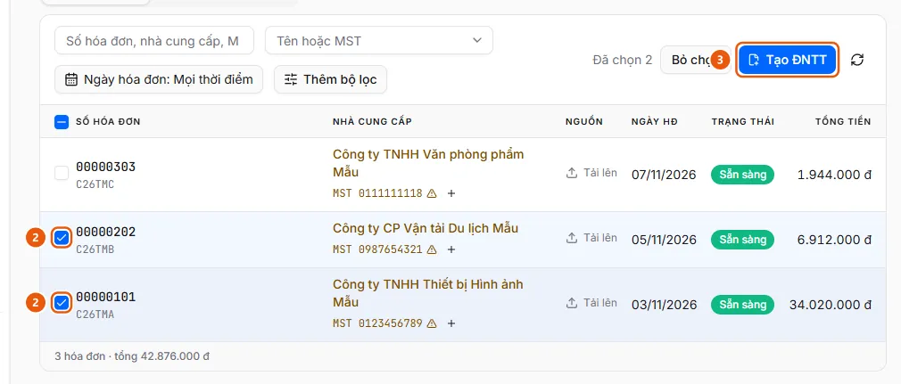
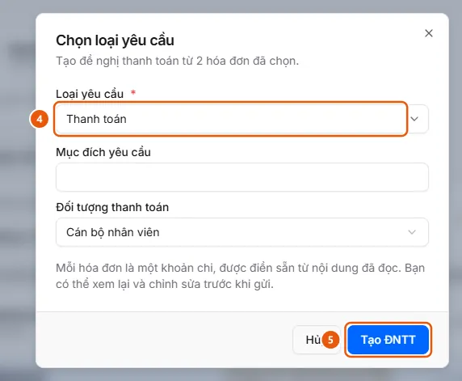

# Chọn hóa đơn và tạo đề nghị thanh toán

Tích các hóa đơn Sẵn sàng ở Quản lý hóa đơn, bấm Tạo ĐNTT, chọn Loại yêu cầu và bấm Tạo ĐNTT; mỗi hóa đơn thành một khoản chi trong bản nháp.

## Trước khi bắt đầu

- **[Điều kiện tạo ĐNTT từ hóa đơn](../../../reference/invoices/create-request-rules.md)**\
  Chỉ chọn được hóa đơn Sẵn sàng, tối đa 50 hóa đơn mỗi đề nghị, và chỉ với loại đề nghị có dùng hóa đơn.
- **[Ai thấy và thao tác được hóa đơn đầu vào](../../../reference/invoices/access.md)**\
  Hóa đơn thuộc đơn vị của người tải lên; đơn vị đó và các đơn vị cấp trên thấy được. Quản trị viên và người vận hành thấy mọi đơn vị.

## Các bước

1. Mở **Quản lý hóa đơn**, tab **Chưa tạo ĐNTT**.
2. Tích ô đầu dòng (2) các hóa đơn **Sẵn sàng** cần thanh toán (tối đa 50), hoặc ô ở tiêu đề để chọn tất cả hóa đơn trên trang. Thanh lệnh hiện "Đã chọn N".

   

3. Bấm **Tạo ĐNTT** (3). Hộp thoại **Chọn loại yêu cầu** mở ra.
4. Chọn **Loại yêu cầu** (4); điền các trường tổng quan mà loại đó hỏi (ví dụ mục đích yêu cầu, đối tượng thanh toán).

   

5. Bấm **Tạo ĐNTT** (5). Hệ thống tạo đề nghị nháp (có số chứng từ) và mở **Quy trình tạo** ở bước **Tổng quan** với các trường vừa điền; tổng đề nghị đã bằng tổng các hóa đơn.
6. Bấm **Tiếp tục** sang **Bảng kê chi phí**: mỗi hóa đơn là một dòng chi phí với số hóa đơn, mô tả và tổng tiền điền sẵn. Xem lại, sửa rồi đi tiếp như khi tạo đề nghị: [Tạo đề nghị và điền đến bước Xem lại](../../requests/how-to/create-draft.md), rồi nộp ở [Nộp đề nghị](../../requests/how-to/submit.md).

## Xử lý lỗi

- Ô chọn bị khóa, nút Tạo ĐNTT bị khóa, hoặc "Có hóa đơn chưa đọc xong" / "Hóa đơn đã nằm trong ĐNTT …": xem [Điều kiện tạo ĐNTT từ hóa đơn](../../../reference/invoices/create-request-rules.md).
- Đóng trang giữa chừng: bản nháp đã được tạo, mở lại ở **Đề nghị thanh toán** → **Đề nghị của tôi**.

## Điều kiện cần kiểm tra

- [Hóa đơn ở trạng thái Sẵn sàng](../../../troubleshooting/invoices/invoice-ready.md) — Hóa đơn đã qua các bước kiểm tra (hoặc được ghi đè, nhập tay) và ở trạng thái Sẵn sàng, chọn được để tạo ĐNTT.

## Kết quả

- [Đang mở một đề nghị nháp](../../../troubleshooting/requests/draft-open.md) — Một đề nghị đang ở trạng thái Bản nháp trong quy trình tạo và đã có số chứng từ.

## Xem thêm

- [Tạo đề nghị thanh toán](../../requests/create-draft.md) — Người dùng muốn lập một đề nghị thanh toán mới và lưu thành bản nháp.

## Được dùng trong các hướng dẫn

- [Tạo ĐNTT từ hóa đơn đã có trong Quản lý hóa đơn](../create-request.md) — Người dùng muốn chọn nhiều hóa đơn đã đọc sẵn trong Quản lý hóa đơn và lập một đề nghị thanh toán, mỗi hóa đơn là một khoản chi.
