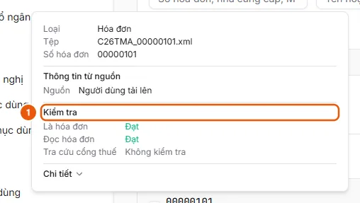

# Xem kết quả kiểm tra và xử lý hóa đơn bị dừng

Mở hóa đơn, xem bước kiểm tra nào dừng; bấm Thử lại khi Gián đoạn, hoặc nhập tay thông tin hóa đơn rồi Lưu khi Cần nhập tay.

## Trước khi bắt đầu

- **[Ai thấy và thao tác được hóa đơn đầu vào](../../../reference/invoices/access.md)**\
  Hóa đơn thuộc đơn vị của người tải lên; đơn vị đó và các đơn vị cấp trên thấy được. Quản trị viên và người vận hành thấy mọi đơn vị.

## Các bước

1. Ở **Quản lý hóa đơn**, rê chuột lên số hóa đơn để xem mục **Kiểm tra** (1): **Là hóa đơn**, **Đọc hóa đơn**, rồi **Tra cứu cổng thuế** (khi chưa có kết quả, đang tra cứu hoặc dừng ở bước này) hoặc từng dòng kết quả Cổng HĐĐT. Mỗi mục có một kết quả:
   - Cần xử lý: Cần nhập tay, Chưa khớp, Không kiểm tra được, Chưa kiểm tra được.
   - Đang chạy: Đang chờ, Đang chạy.
   - Xong: Đạt, Khớp một phần, Đã ghi đè, Không kiểm tra.

   

2. Bấm vào dòng để mở hóa đơn. Khung kiểm tra ghi lý do dừng: "Không phải hóa đơn", "Không hợp lệ trên cổng thuế", hoặc "Dừng ở bước phân loại tệp / đọc hóa đơn / tra cứu cổng thuế", kèm **Kết quả tra cứu cổng thuế**.
3. Trạng thái **Gián đoạn**: bấm **Thử lại** để chạy lại bước đã dừng.
4. Trạng thái **Cần nhập tay** (hoặc Sẵn sàng nhưng đọc sai): sửa các trường ở thẻ **Thông tin hóa đơn**, **Thêm dòng** hàng hóa nếu cần, rồi bấm **Lưu**. Nếu nguồn của hóa đơn bật **Kiểm tra trên Cổng HĐĐT** (và hóa đơn chưa được nguồn xác thực sẵn), hóa đơn chuyển sang **Đang tra cứu** để tra cứu lại; nếu không, chuyển ngay sang **Sẵn sàng**.
5. Trạng thái **Bị từ chối**, hoặc bạn tin hóa đơn vẫn dùng được: ghi đè theo [Ghi đè kết quả kiểm tra hóa đơn](overrule-check.md).

## Xử lý lỗi

- "Hóa đơn vừa thay đổi trạng thái. Đã tải lại.": hóa đơn đã chuyển bước trong lúc bạn xem; đọc lại trạng thái mới rồi thao tác lại.
- Lưu không đi tiếp và các ô bắt buộc bị tô đỏ: khi hóa đơn cần tra cứu trên Cổng HĐĐT, phải có đủ Mã số thuế người bán, Mẫu số hóa đơn, Ký hiệu hóa đơn, Số hóa đơn và Tổng tiền thanh toán (tên trường theo danh mục loại chứng từ Hóa đơn).
- Hóa đơn đã nằm trong một đề nghị thì không sửa được. Xem [Điều kiện tạo ĐNTT từ hóa đơn](../../../reference/invoices/create-request-rules.md).

## Kết quả

- [Hóa đơn ở trạng thái Sẵn sàng](../../../troubleshooting/invoices/invoice-ready.md) — Hóa đơn đã qua các bước kiểm tra (hoặc được ghi đè, nhập tay) và ở trạng thái Sẵn sàng, chọn được để tạo ĐNTT.

## Được dùng trong các hướng dẫn

- [Xử lý hóa đơn bị từ chối, gián đoạn hoặc cần nhập tay](../review-check.md) — Người dùng muốn biết vì sao hóa đơn chưa Sẵn sàng và xử lý: thử lại, nhập tay thông tin, hoặc ghi đè kết quả kiểm tra.
- [Ghi đè kết quả kiểm tra hóa đơn](overrule-check.md) — Trên hóa đơn Bị từ chối hoặc Gián đoạn, bấm Ghi đè, nhập lý do (không bắt buộc) và xác nhận; hóa đơn đi tiếp, người ghi đè và lý do được lưu.
- [Tải tệp hóa đơn lên Quản lý hóa đơn](upload.md) — Ở Quản lý hóa đơn, bấm Tải lên trên thẻ Người dùng tải lên, chọn tệp XML/PDF/ảnh hoặc zip rồi bấm Tải lên; hệ thống tự đọc từng hóa đơn.
- [Hóa đơn ở trạng thái Sẵn sàng](../../../troubleshooting/invoices/invoice-ready.md) — Hóa đơn đã qua các bước kiểm tra (hoặc được ghi đè, nhập tay) và ở trạng thái Sẵn sàng, chọn được để tạo ĐNTT.
