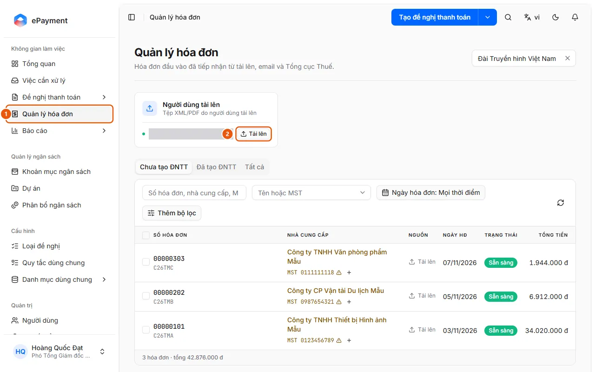
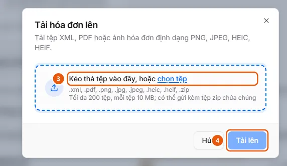

# Tải tệp hóa đơn lên Quản lý hóa đơn

Ở Quản lý hóa đơn, bấm Tải lên trên thẻ Người dùng tải lên, chọn tệp XML/PDF/ảnh hoặc zip rồi bấm Tải lên; hệ thống tự đọc từng hóa đơn.

## Trước khi bắt đầu

- **[Định dạng, dung lượng và trùng lặp khi tải hóa đơn](../../../reference/invoices/file-types.md)**\
  Nhận XML, PDF, ảnh PNG/JPEG/HEIC/HEIF (hoặc zip chứa chúng), tối đa 200 tệp, mỗi tệp 10 MB mặc định; tệp trùng trong đơn vị không tải lên được.
- **[Ai thấy và thao tác được hóa đơn đầu vào](../../../reference/invoices/access.md)**\
  Hóa đơn thuộc đơn vị của người tải lên; đơn vị đó và các đơn vị cấp trên thấy được. Quản trị viên và người vận hành thấy mọi đơn vị.

## Các bước

1. Mở **Quản lý hóa đơn** (1) ở thanh bên.

   

2. Trên thẻ nguồn **Người dùng tải lên** ("Tệp XML/PDF do người dùng tải lên"), bấm **Tải lên** (2). Hộp thoại **Tải hóa đơn lên** mở ra.
3. Kéo thả hoặc chọn tệp (3): XML, PDF, ảnh PNG/JPEG/HEIC/HEIF, hoặc tệp zip chứa chúng (tối đa 200 tệp). Danh sách **Tệp đã chọn** hiện từng tệp; tệp không hợp lệ hiện lý do, bấm dấu X để gỡ. Muốn thêm tệp, kéo thả hoặc **chọn tệp** lần nữa ở ô **Thêm tệp** phía trên danh sách.

   

4. Bấm **Tải lên** (4). Thông báo "Đã gửi N hóa đơn để đọc". Nếu mọi tệp được nhận, hộp thoại đóng; nếu có tệp trùng, hộp thoại ở lại và liệt kê chúng dưới **Đã có trong hộp thư** (các tệp khác vẫn được gửi), bấm **Hủy** để đóng.
5. Theo dõi hóa đơn mới trong danh sách: trạng thái tự chuyển Đã nhận → Đang phân loại → Đang đọc → (Đang tra cứu) → **Sẵn sàng**, không cần tải lại trang. Hóa đơn XML thường Sẵn sàng sau vài giây; tệp không phải hóa đơn thành **Bị từ chối**.

## Xử lý lỗi

- "Đã có trong hộp thư": tệp trùng với hóa đơn mà đơn vị đã có, không được thêm lại; bấm **Xem** để mở hóa đơn cũ. Xem [Định dạng, dung lượng và trùng lặp khi tải hóa đơn](../../../reference/invoices/file-types.md).
- "Nguồn tải lên đang tắt. Bật lại trong Quản trị › Hóa đơn đầu vào": nhờ quản trị viên bật nguồn ([Bật/tắt nguồn hóa đơn và lưu thiết lập](../../invoice-sources/how-to/configure.md)).
- Hóa đơn dừng ở Bị từ chối, Gián đoạn hoặc Cần nhập tay: xem [Xem kết quả kiểm tra và xử lý hóa đơn bị dừng](review-check.md).

## Điều kiện cần kiểm tra

- [Nguồn Người dùng tải lên đang bật](../../../troubleshooting/invoice-sources/upload-enabled.md) — Nguồn hóa đơn Người dùng tải lên đang bật, nên người dùng tải được tệp hóa đơn lên trang Quản lý hóa đơn.

## Được dùng trong các hướng dẫn

- [Tải hóa đơn đầu vào lên Quản lý hóa đơn](../upload.md) — Người dùng muốn đưa tệp hóa đơn (XML, PDF, ảnh, zip) vào kho Quản lý hóa đơn để hệ thống tự đọc và kiểm tra, trước khi lập đề nghị.
