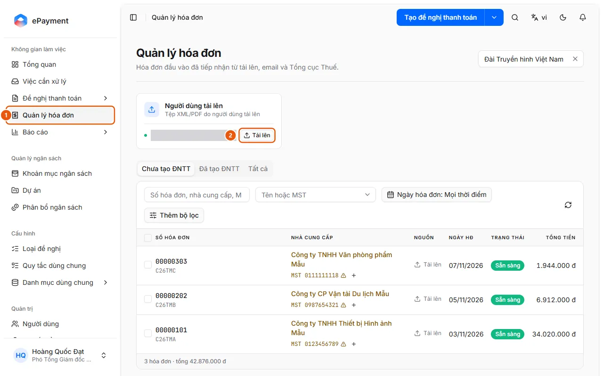
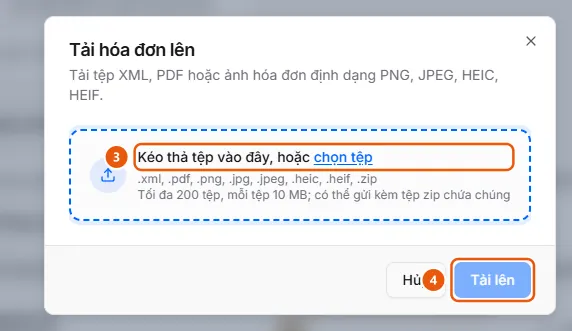

# Tải hóa đơn đầu vào lên Quản lý hóa đơn

Người dùng muốn đưa tệp hóa đơn (XML, PDF, ảnh, zip) vào kho Quản lý hóa đơn để hệ thống tự đọc và kiểm tra, trước khi lập đề nghị.

**Khi nào sử dụng:**

- Người dùng có tệp hóa đơn nhà cung cấp gửi và muốn lưu vào Quản lý hóa đơn trước, chưa lập đề nghị ngay.
- Người dùng có một tệp zip nhiều hóa đơn cần đưa vào hệ thống.
- Người dùng muốn thêm tệp PDF, XML hoặc ảnh hóa đơn của nhà cung cấp vào danh sách hóa đơn.

Hóa đơn tải lên được gán cho đơn vị của bạn, tự đọc và kiểm tra, rồi chờ ở tab Chưa tạo ĐNTT. Muốn đọc hóa đơn thẳng vào một đề nghị đang soạn thì xem [Lập chi phí từ hóa đơn có sẵn](../requests/add-invoice-expense.md).

## Các cách thực hiện

- [Tải tệp hóa đơn lên Quản lý hóa đơn](how-to/upload.md) — Ở Quản lý hóa đơn, bấm Tải lên trên thẻ Người dùng tải lên, chọn tệp XML/PDF/ảnh hoặc zip rồi bấm Tải lên; hệ thống tự đọc từng hóa đơn.

## Xem thêm

- [Lập chi phí từ hóa đơn có sẵn](../requests/add-invoice-expense.md) — Người dùng có hóa đơn (XML, PDF, ảnh) hoặc hóa đơn đã có trong Quản lý hóa đơn và muốn mỗi hóa đơn thành một dòng chi phí đã điền sẵn.

## Được dùng trong các hướng dẫn

- [Thêm chi phí từ hóa đơn](../requests/how-to/add-invoice-expense.md) — Ở bước Bảng kê chi phí, chọn Thêm từ hóa đơn, tải hóa đơn lên hoặc chọn từ danh sách Quản lý hóa đơn; mỗi hóa đơn thành một dòng chi phí.
- [AkaPayment](../../overview.md) — Lập, duyệt và theo dõi đề nghị thanh toán; tiếp nhận hóa đơn đầu vào, đối soát chứng từ và quản lý ngân sách, có trợ lý AI.

## Trước khi bắt đầu

- **[Định dạng, dung lượng và trùng lặp khi tải hóa đơn](../../reference/invoices/file-types.md)**\
  Nhận XML, PDF, ảnh PNG/JPEG/HEIC/HEIF (hoặc zip chứa chúng), tối đa 200 tệp, mỗi tệp 10 MB mặc định; tệp trùng trong đơn vị không tải lên được.
- **[Ai thấy và thao tác được hóa đơn đầu vào](../../reference/invoices/access.md)**\
  Hóa đơn thuộc đơn vị của người tải lên; đơn vị đó và các đơn vị cấp trên thấy được. Quản trị viên và người vận hành thấy mọi đơn vị.

## Các bước

[Tải tệp hóa đơn lên Quản lý hóa đơn](how-to/upload.md)

Điều kiện khả dụng: kiểm tra yêu cầu về gói và quyền

1. Kiểm tra [Nguồn Người dùng tải lên đang bật](../../troubleshooting/invoice-sources/upload-enabled.md).
   Ở Quản lý hóa đơn không có cảnh báo "Nguồn tải lên đang tắt. Bật lại trong Quản trị › Hóa đơn đầu vào" và có thẻ nguồn "Người dùng tải lên" với nút Tải lên. Với quản trị viên: ở Quản trị → Hóa đơn đầu vào, thẻ "Người dùng tải lên" hiện "Đang bật".
   Nếu chưa đáp ứng: làm theo [Bật/tắt nguồn hóa đơn và lưu thiết lập](../invoice-sources/how-to/configure.md) bên dưới.
2. [Bật/tắt nguồn hóa đơn và lưu thiết lập](../invoice-sources/how-to/configure.md) — chỉ khi [Nguồn Người dùng tải lên đang bật](../../troubleshooting/invoice-sources/upload-enabled.md) chưa được đáp ứng
   1. Mở **Quản trị** → **Hóa đơn đầu vào** (trên máy tính).
   2. Ở ô **Đơn vị**, để **Tất cả đơn vị** để sửa mặc định của tổ chức, hoặc chọn một đơn vị để đặt riêng tần suất và lịch tải cho đơn vị đó.
   3. Bật hoặc tắt công tắc của từng thẻ nguồn (nhãn **Đang bật** / **Đã tắt**): **Người dùng tải lên**, **Email**, **Tải định kỳ từ TCT**, **Kết nối AkaConnect**, **Tài khoản AkaPay**.
   4. Với các nguồn nhận tệp (Người dùng tải lên, Email, AkaConnect), chọn **Định dạng chấp nhận** (XML, PDF, Ảnh) và **Dung lượng tối đa mỗi tệp** (5, 10 hoặc 15 MB).
   5. Bật **Kiểm tra trên Cổng HĐĐT** ("Tự động kiểm tra sau khi tải lên" / "sau khi nhận") ở các nguồn cần tra cứu tình trạng hóa đơn và người bán ngay khi nhận.
   6. Chọn **Tần suất đồng bộ** cho Email (Thời gian thực, Mỗi 5/15/30 phút, Mỗi giờ), AkaConnect và AkaPay (Mỗi 5/15/30 phút, Mỗi giờ; không có Thời gian thực) và **Lịch tải** cho **Tải định kỳ từ TCT**. Ở một đơn vị, bấm **Dùng mặc định** để bỏ giá trị riêng.
   7. Bấm **Lưu thay đổi**. Nếu đang chọn một đơn vị mà đã đổi mục áp dụng cho cả tổ chức, hộp thoại **Áp dụng cho tất cả đơn vị?** liệt kê thay đổi; bấm **Lưu và áp dụng cho tất cả**. Thông báo "Đã lưu cấu hình nguồn hóa đơn".
3. [Tải tệp hóa đơn lên Quản lý hóa đơn](how-to/upload.md)
   1. Mở **Quản lý hóa đơn** (1) ở thanh bên.
      
   2. Trên thẻ nguồn **Người dùng tải lên** ("Tệp XML/PDF do người dùng tải lên"), bấm **Tải lên** (2). Hộp thoại **Tải hóa đơn lên** mở ra.
   3. Kéo thả hoặc chọn tệp (3): XML, PDF, ảnh PNG/JPEG/HEIC/HEIF, hoặc tệp zip chứa chúng (tối đa 200 tệp). Danh sách **Tệp đã chọn** hiện từng tệp; tệp không hợp lệ hiện lý do, bấm dấu X để gỡ. Muốn thêm tệp, kéo thả hoặc **chọn tệp** lần nữa ở ô **Thêm tệp** phía trên danh sách.
      
   4. Bấm **Tải lên** (4). Thông báo "Đã gửi N hóa đơn để đọc". Nếu mọi tệp được nhận, hộp thoại đóng; nếu có tệp trùng, hộp thoại ở lại và liệt kê chúng dưới **Đã có trong hộp thư** (các tệp khác vẫn được gửi), bấm **Hủy** để đóng.
   5. Theo dõi hóa đơn mới trong danh sách: trạng thái tự chuyển Đã nhận → Đang phân loại → Đang đọc → (Đang tra cứu) → **Sẵn sàng**, không cần tải lại trang. Hóa đơn XML thường Sẵn sàng sau vài giây; tệp không phải hóa đơn thành **Bị từ chối**.

## Lưu ý

- **[Thiết lập nguồn hóa đơn: chung cho tổ chức hay riêng từng đơn vị](../../reference/invoice-sources/unit-scope.md)**\
  Bật/tắt, định dạng, dung lượng và Kiểm tra trên Cổng HĐĐT áp dụng cho cả tổ chức; tần suất, lịch tải và tài khoản nguồn đặt riêng theo đơn vị.

## Nếu có sự cố

### [Bật/tắt nguồn hóa đơn và lưu thiết lập](../invoice-sources/how-to/configure.md)

- Mục nào chung cho tổ chức, mục nào riêng đơn vị: [Thiết lập nguồn hóa đơn: chung cho tổ chức hay riêng từng đơn vị](../../reference/invoice-sources/unit-scope.md).
- Bật nguồn chưa đủ để nhận hóa đơn qua email, Cổng HĐĐT, AkaConnect, AkaPay: còn phải khai báo hòm thư hoặc tài khoản, xem [Thêm hòm thư nhận hóa đơn qua IMAP](../invoice-sources/how-to/connect-mailbox.md), [Tải hóa đơn định kỳ từ Cổng HĐĐT Tổng cục Thuế](../invoice-sources/how-to/connect-tax-portal.md), [Kết nối hòm thư Gmail/Outlook qua AkaConnect](../invoice-sources/how-to/connect-akaconnect.md), [Kết nối tài khoản AkaPay bằng API key](../invoice-sources/how-to/connect-akapay.md).

### [Tải tệp hóa đơn lên Quản lý hóa đơn](how-to/upload.md)

- "Đã có trong hộp thư": tệp trùng với hóa đơn mà đơn vị đã có, không được thêm lại; bấm **Xem** để mở hóa đơn cũ. Xem [Định dạng, dung lượng và trùng lặp khi tải hóa đơn](../../reference/invoices/file-types.md).
- "Nguồn tải lên đang tắt. Bật lại trong Quản trị › Hóa đơn đầu vào": nhờ quản trị viên bật nguồn ([Bật/tắt nguồn hóa đơn và lưu thiết lập](../invoice-sources/how-to/configure.md)).
- Hóa đơn dừng ở Bị từ chối, Gián đoạn hoặc Cần nhập tay: xem [Xem kết quả kiểm tra và xử lý hóa đơn bị dừng](how-to/review-check.md).
