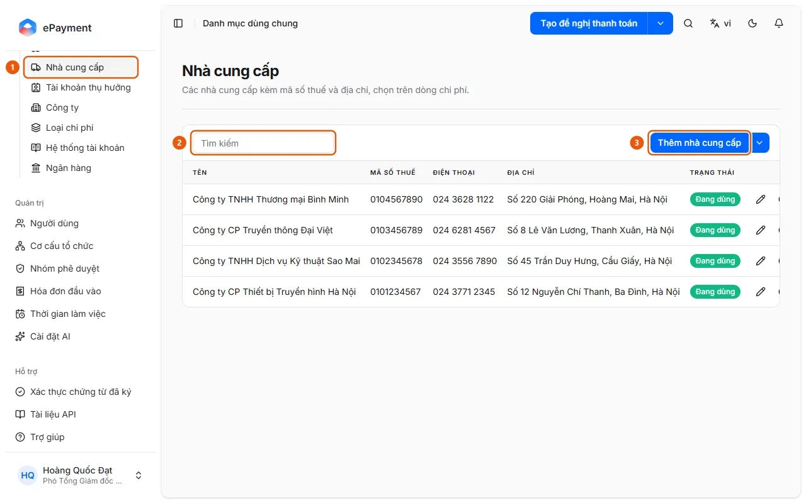

# Cập nhật danh mục dùng chung

Quản trị viên muốn thêm hoặc sửa bản ghi danh mục: nhà cung cấp, ngân hàng, loại chi phí, hay khoản mục ngân sách và dự án.

**Khi nào sử dụng:**

- Hóa đơn của nhà cung cấp mới chưa có trong hệ thống.
- Cần một khoản mục ngân sách hoặc dự án mới trước khi phân bổ ngân sách.
- Người dùng muốn tạo dự án mới để phân bổ ngân sách theo dự án.
- Quản trị viên muốn thêm hoặc sửa một mục trong danh mục dùng chung.

Có 14 danh mục dùng chung một màn hình; 12 danh mục nằm ở Cấu hình → Danh mục dùng chung: tiền tệ, hình thức thanh toán, loại hóa đơn, loại chứng từ, loại thuế, điều khoản thanh toán, nhà cung cấp, tài khoản thụ hưởng, công ty, loại chi phí, hệ thống tài khoản, ngân hàng. Khoản mục ngân sách và Dự án nằm ở Quản lý ngân sách.

## Các cách thực hiện

- [Thêm hoặc sửa một bản ghi danh mục](how-to/manage-list.md) — Mở danh mục (Cấu hình → Danh mục dùng chung, hoặc Quản lý ngân sách → Khoản mục ngân sách / Dự án), bấm nút Thêm hoặc Sửa bản ghi ở dòng, rồi Lưu.

## Trước khi bắt đầu

- **[Quy tắc trùng trong danh mục dùng chung](../../reference/master-data/duplicates.md)**\
  Không tạo được nhà cung cấp trùng mã số thuế, tài khoản thụ hưởng trùng số tài khoản và ngân hàng, hay loại chi phí trùng mã; hệ thống chỉ ra bản ghi đã có.

## Các bước

[Thêm hoặc sửa một bản ghi danh mục](how-to/manage-list.md)

1. [Thêm hoặc sửa một bản ghi danh mục](how-to/manage-list.md)
   1. Mở danh mục: ở thanh bên, mục **Cấu hình** → **Danh mục dùng chung** rồi chọn danh mục (1) (Nhà cung cấp, Ngân hàng, Loại chi phí, Tài khoản thụ hưởng…); riêng **Khoản mục ngân sách** và **Dự án** nằm ở mục **Quản lý ngân sách**.
      
   2. Dùng ô **Tìm kiếm** (2) để tìm bản ghi đã có (Nhà cung cấp và Tài khoản thụ hưởng cần gõ vài ký tự; Tài khoản thụ hưởng lọc thêm theo loại).
   3. Bấm nút **Thêm …** (3) trên thanh công cụ (ví dụ **Thêm nhà cung cấp**: Tên, Mã số thuế, Địa chỉ, Điện thoại, Email và **Thêm tài khoản mới** cho tài khoản thụ hưởng; **Thêm khoản mục** / **Thêm dự án**: Tên, Mô tả), hoặc biểu tượng bút **Sửa bản ghi** ở dòng; bấm **Lưu**.
   4. Để bỏ khỏi danh sách chọn mà không xóa, dùng **Ngừng sử dụng** ở dòng (và **Sử dụng lại** để bật lại); loại chứng từ Hóa đơn không ngừng sử dụng được.
   5. Menu mũi tên cạnh nút Thêm có **Xuất Excel**; tùy danh mục còn có **Nhập từ Excel** (tài khoản thụ hưởng của nhân viên), **Nhập loại tài liệu** (Loại chứng từ, từ tệp JSON) và **Đồng bộ dữ liệu hệ thống** (các danh mục hệ thống như tiền tệ, ngân hàng, loại thuế).

## Nếu có sự cố

### [Thêm hoặc sửa một bản ghi danh mục](how-to/manage-list.md)

- Trùng mã số thuế, tài khoản hoặc mã loại chi phí: xem [Quy tắc trùng trong danh mục dùng chung](../../reference/master-data/duplicates.md).
