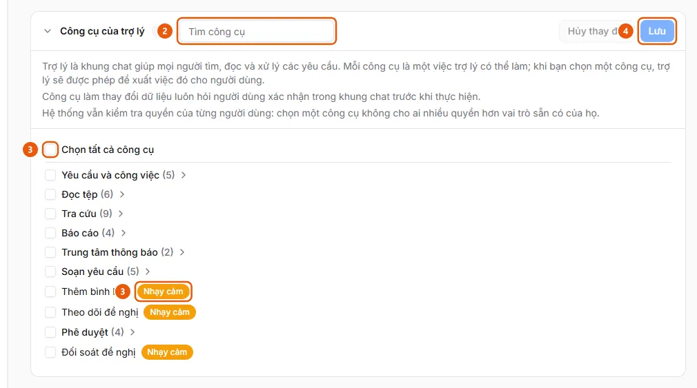

# Chọn cách mở trợ lý cho riêng tôi

Người dùng muốn trợ lý mở ở Bảng bên phải hoặc Bong bóng nổi trên trình duyệt của mình, khác mặc định của tổ chức.

**Khi nào sử dụng:**

- Người dùng thấy bảng trợ lý che nội dung và muốn dùng Bong bóng nổi.
- Người dùng muốn đưa trợ lý về Bảng bên phải trên máy của mình.

Lựa chọn chỉ lưu trong trình duyệt đang dùng; trên điện thoại trợ lý luôn mở ở Bảng bên phải.

## Các cách thực hiện

- [Chọn cách mở trợ lý trong Tùy chọn](how-to/set-assistant-display.md) — Trong Hồ sơ cá nhân, tab Tùy chọn, ở dòng Trợ lý AI chọn Theo tổ chức, Bảng bên phải hoặc Bong bóng nổi; chỉ lưu trong trình duyệt này.

## Xem thêm

- [Đặt cách mở trợ lý mặc định: Bảng bên phải hay Bong bóng nổi](../admin/set-assistant-display.md) — Quản trị viên muốn chọn cách trợ lý mở cho cả tổ chức: Bảng bên phải hoặc Bong bóng nổi kéo được.

## Được dùng trong các hướng dẫn

- [Đặt cách mở trợ lý mặc định: Bảng bên phải hay Bong bóng nổi](../admin/set-assistant-display.md) — Quản trị viên muốn chọn cách trợ lý mở cho cả tổ chức: Bảng bên phải hoặc Bong bóng nổi kéo được.

## Các bước

[Chọn cách mở trợ lý trong Tùy chọn](how-to/set-assistant-display.md)

1. Kiểm tra [Trợ lý AI đã được bật cho vai trò của bạn](../../troubleshooting/assistant/tools-enabled.md).
   Đầu trang có nút ✨ "Trợ lý AI" (hoặc bong bóng nổi ở góc màn hình); không có thì trợ lý chưa được bật cho bạn.
   Nếu chưa đáp ứng: làm theo [Bật công cụ của trợ lý](../admin/how-to/enable-assistant-tools.md) bên dưới.
2. [Bật công cụ của trợ lý](../admin/how-to/enable-assistant-tools.md) — chỉ khi [Trợ lý AI đã được bật cho vai trò của bạn](../../troubleshooting/assistant/tools-enabled.md) chưa được đáp ứng
   1. Ở thanh bên, mục **Quản trị**, mở **Cài đặt AI** (chỉ quản trị viên, trên máy tính) và chọn tab **Trợ lý**.
   2. Mở mục **Công cụ của trợ lý** (chia nhóm: Yêu cầu và công việc, Đọc tệp, Tra cứu, Báo cáo, Trung tâm thông báo, Soạn yêu cầu, Phê duyệt). Dùng ô **Tìm công cụ** (2) để lọc; di chuột lên tên công cụ để xem nó làm gì và dành cho vai trò nào.
      
   3. Đánh dấu từng công cụ, ô của một nhóm, hoặc **Chọn tất cả công cụ** (3). Công cụ có nhãn **Nhạy cảm** (3) làm thay đổi dữ liệu và luôn hỏi người dùng xác nhận trong khung chat; **Đối soát đề nghị** chỉ dành cho người vận hành và quản trị viên.
   4. Bấm **Lưu** (4) ("Đã lưu các công cụ của trợ lý."), hoặc **Hủy thay đổi** để bỏ các dấu chưa lưu.
3. [Chọn cách mở trợ lý trong Tùy chọn](how-to/set-assistant-display.md)
   1. Bấm thẻ người dùng ở góc dưới thanh bên → **Hồ sơ cá nhân**.
   2. Chọn tab **Tùy chọn** ("Chỉ áp dụng cho trình duyệt này, không lưu vào tài khoản.").
   3. Ở dòng **Trợ lý AI**, chọn **Theo tổ chức (…)** (theo mặc định quản trị viên đặt), **Bảng bên phải** hoặc **Bong bóng nổi**. Lựa chọn có hiệu lực ngay.

## Nếu có sự cố

### [Bật công cụ của trợ lý](../admin/how-to/enable-assistant-tools.md)

- "Không tải được các công cụ của trợ lý": dịch vụ trợ lý không phản hồi hoặc bạn không có quyền quản lý; bấm **Thử lại**.
- Bật một công cụ không mở thêm quyền cho ai: ứng dụng vẫn kiểm tra quyền của từng người ở mọi thao tác.

### [Chọn cách mở trợ lý trong Tùy chọn](how-to/set-assistant-display.md)

- Không thấy dòng **Trợ lý AI**: trợ lý chưa được bật cho bạn, hoặc màn hình hẹp như điện thoại (dưới 768 px; khi đó trợ lý luôn mở ở **Bảng bên phải**).
- Đổi trình duyệt hoặc máy khác thì lựa chọn trở về **Theo tổ chức**.
