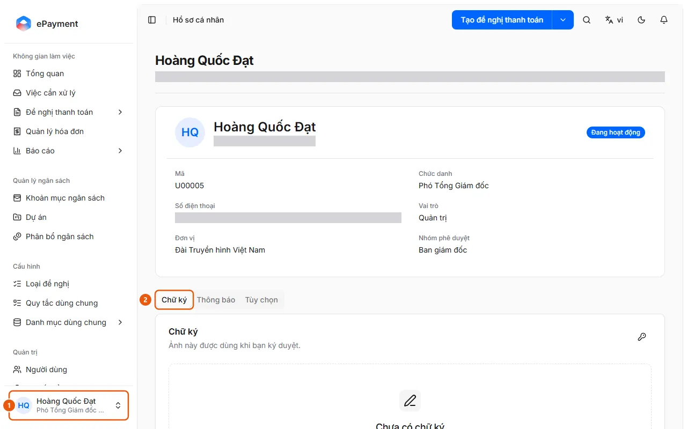
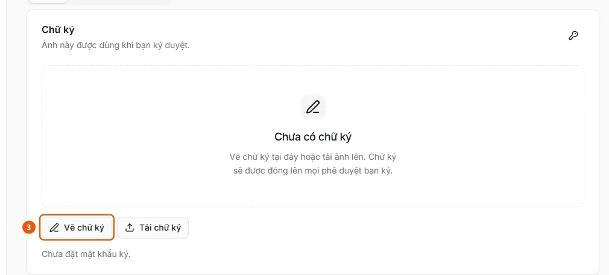

# Đặt chữ ký để ký duyệt

Người dùng cần chữ ký cá nhân để ký khi duyệt đề nghị.

**Khi nào sử dụng:**

- Người duyệt chưa có chữ ký nhưng loại đề nghị yêu cầu ký.
- Người duyệt cần lưu sẵn chữ ký trước khi duyệt.

Lưu chữ ký vẽ tay hoặc ảnh trong hồ sơ.

## Các cách thực hiện

- [Đặt chữ ký và mật khẩu ký trong hồ sơ](how-to/set-signature.md) — Trong Hồ sơ cá nhân, tab Chữ ký, vẽ hoặc tải ảnh chữ ký và đặt mật khẩu ký để dùng khi ký duyệt.

## Các bước

[Đặt chữ ký và mật khẩu ký trong hồ sơ](how-to/set-signature.md)

1. [Đặt chữ ký và mật khẩu ký trong hồ sơ](how-to/set-signature.md)
   1. Bấm thẻ người dùng (1) ở góc dưới thanh bên → **Hồ sơ cá nhân**.
      
   2. Chọn tab **Chữ ký** (2) ("Ảnh này được dùng khi bạn ký duyệt").
   3. Bấm **Vẽ chữ ký** (3), ký trong khung bằng chuột, bàn di chuột hoặc ngón tay (**Xóa nét vẽ** để vẽ lại), rồi **Dùng chữ ký này**; hoặc **Tải chữ ký** (**Thay ảnh khác** khi đã có) để chọn ảnh PNG, JPEG hoặc WEBP, tối đa 256 KB; **Gỡ chữ ký** để xóa.
      
   4. Nếu chưa có mật khẩu ký, hộp thoại **Mật khẩu ký** tự mở sau khi lưu chữ ký; nhập mật khẩu ít nhất 6 ký tự và nhập lại. Để đổi sau này, bấm biểu tượng chìa khóa ở góc thẻ (hộp thoại **Đổi mật khẩu ký** hỏi thêm mật khẩu hiện tại). Trang hiện "Đã đặt mật khẩu ký." khi đã có.

## Nếu có sự cố

### [Đặt chữ ký và mật khẩu ký trong hồ sơ](how-to/set-signature.md)

- "Ảnh chữ ký quá lớn." hoặc "Dùng ảnh PNG, JPEG hoặc WEBP.": chọn ảnh khác. "Mật khẩu ký hiện tại không đúng.": nhập lại; quên mật khẩu thì nhờ quản trị viên **Đặt lại mật khẩu ký** ở **Quản trị** → **Người dùng**.
