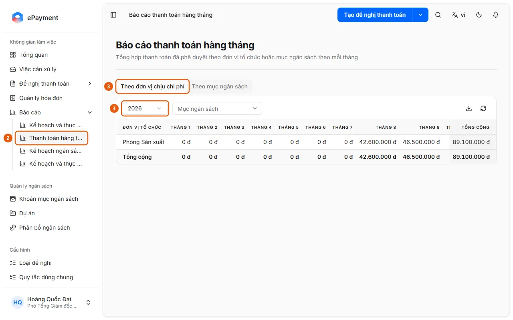

# Mở báo cáo thanh toán hàng tháng

Ở thanh bên mở Báo cáo → Thanh toán hàng tháng, chọn năm và xem tổng đã duyệt theo tháng.

## Các bước

1. Ở thanh bên mở **Báo cáo**.
2. Chọn **Thanh toán hàng tháng** (2) (tổng hợp thanh toán đã phê duyệt theo đơn vị tổ chức hoặc mục ngân sách theo mỗi tháng).

   

3. Chọn tab **Theo đơn vị chịu chi phí** (3) hoặc **Theo mục ngân sách** (chỉ có tab mục ngân sách khi ngân sách không theo đơn vị), chọn **Năm** (3); lọc theo **Mục ngân sách** (tab đơn vị) hoặc **Đơn vị tổ chức** (tab mục ngân sách) nếu cần.
4. Đọc bảng Tháng 1 đến Tháng 12 và Tổng cộng; dùng biểu tượng tải xuống (**Xuất Excel**) để xuất và biểu tượng làm mới để tải lại.

## Được dùng trong các hướng dẫn

- [Xem thanh toán theo tháng](../review-payments.md) — Người dùng muốn xem tổng hợp các khoản thanh toán theo từng tháng.
