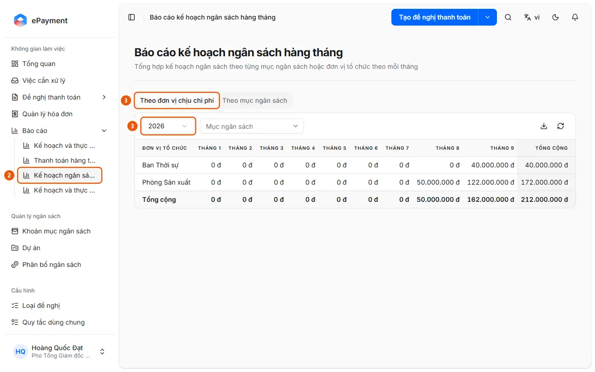

# Mở báo cáo kế hoạch ngân sách hàng tháng

Ở thanh bên mở Báo cáo → Kế hoạch ngân sách hàng tháng, chọn năm và xem số đã phân bổ của từng tháng theo đơn vị hoặc mục ngân sách.

## Các bước

1. Ở thanh bên mở **Báo cáo** (chỉ có trên máy tính).
2. Chọn **Kế hoạch ngân sách hàng tháng** (2) (trang "Báo cáo kế hoạch ngân sách hàng tháng": tổng hợp kế hoạch ngân sách theo từng mục ngân sách hoặc đơn vị tổ chức theo mỗi tháng).

   

3. Chọn tab **Theo đơn vị chịu chi phí** (3) (chỉ có khi ngân sách phân bổ theo đơn vị) hoặc **Theo mục ngân sách**, rồi chọn **Năm** (3) (mặc định năm hiện tại).
4. Lọc theo **Mục ngân sách** (tab đơn vị) hoặc **Đơn vị tổ chức** (tab mục ngân sách) nếu cần.
5. Đọc bảng Tháng 1 đến Tháng 12 và cột Tổng cộng (số tiền đã phân bổ); dùng biểu tượng tải xuống (**Xuất Excel**) để xuất, biểu tượng làm mới để tải lại.

## Xử lý lỗi

- "Không có số liệu trong kỳ này.": không có phân bổ nào trong năm khớp bộ lọc; đổi năm hoặc bỏ bộ lọc, hoặc phân bổ ở [Phân bổ ngân sách cho một kỳ](../../budget/how-to/allocate.md).

## Được dùng trong các hướng dẫn

- [Xem kế hoạch ngân sách theo từng tháng](../review-plan-monthly.md) — Người dùng muốn xem ngân sách đã phân bổ của từng tháng trong năm, theo đơn vị hoặc khoản mục ngân sách.
