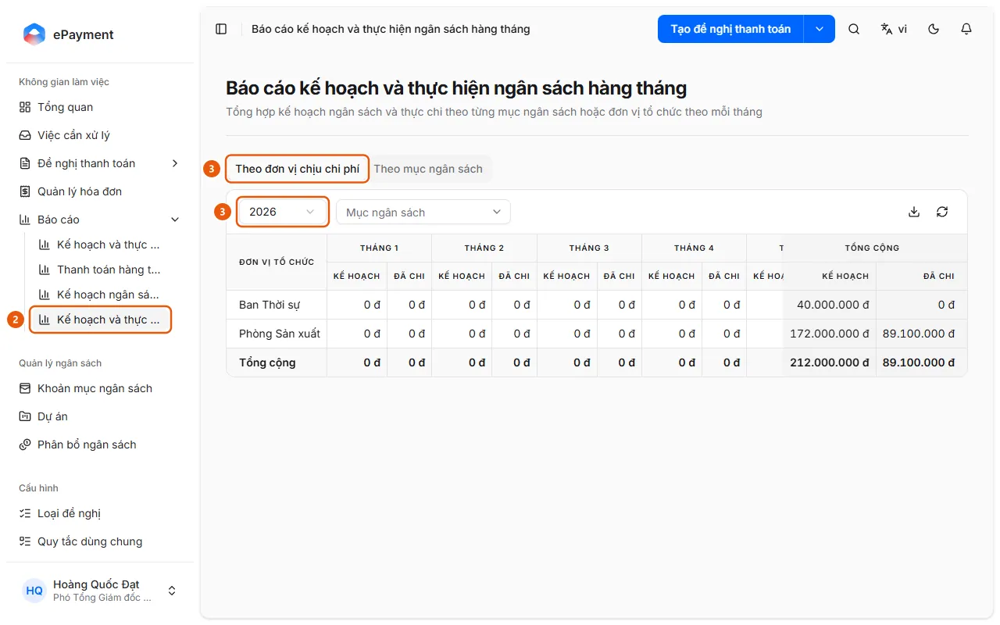

# So sánh kế hoạch với thực chi từng tháng

Người dùng muốn thấy, cho mỗi tháng trong năm, ngân sách kế hoạch bên cạnh số đã chi.

**Khi nào sử dụng:**

- Người dùng muốn xem tháng nào chi vượt hoặc chưa dùng hết kế hoạch ngân sách trong năm.
- Người dùng muốn xem số kế hoạch và số đã chi cạnh nhau cho từng tháng.

Báo cáo Kế hoạch và thực hiện ngân sách hàng tháng: mỗi tháng có cột Kế hoạch và Đã chi.

## Các cách thực hiện

- [Mở báo cáo kế hoạch và thực hiện ngân sách hàng tháng](how-to/review-plan-vs-actual-monthly.md) — Ở thanh bên mở Báo cáo → Kế hoạch và thực hiện ngân sách hàng tháng, chọn năm và so sánh Kế hoạch với Đã chi của từng tháng.

## Các bước

[Mở báo cáo kế hoạch và thực hiện ngân sách hàng tháng](how-to/review-plan-vs-actual-monthly.md)

1. [Mở báo cáo kế hoạch và thực hiện ngân sách hàng tháng](how-to/review-plan-vs-actual-monthly.md)
   1. Ở thanh bên mở **Báo cáo** (chỉ có trên máy tính).
   2. Chọn **Kế hoạch và thực hiện ngân sách hàng tháng** (2) (trang "Báo cáo kế hoạch và thực hiện ngân sách hàng tháng").
      
   3. Chọn tab **Theo đơn vị chịu chi phí** (3) (chỉ có khi ngân sách phân bổ theo đơn vị) hoặc **Theo mục ngân sách**, rồi chọn **Năm** (3).
   4. Lọc theo **Mục ngân sách** (tab đơn vị) hoặc **Đơn vị tổ chức** (tab mục ngân sách) nếu cần.
   5. Đọc từng tháng qua hai cột **Kế hoạch** (đã phân bổ) và **Đã chi** (đề nghị đã duyệt hoặc đã thanh toán), cùng Tổng cộng; dùng biểu tượng tải xuống (**Xuất Excel**) để xuất.

## Nếu có sự cố

### [Mở báo cáo kế hoạch và thực hiện ngân sách hàng tháng](how-to/review-plan-vs-actual-monthly.md)

- "Không có số liệu trong kỳ này.": năm hoặc bộ lọc đang chọn không có kế hoạch lẫn khoản đã chi; đổi năm hoặc bỏ bộ lọc.
- Cần so sánh trên một khoảng tháng bất kỳ kèm "Số đầu kì" và % sử dụng thay vì từng tháng: dùng [Mở báo cáo kế hoạch và thực hiện ngân sách](how-to/review-budget.md).
