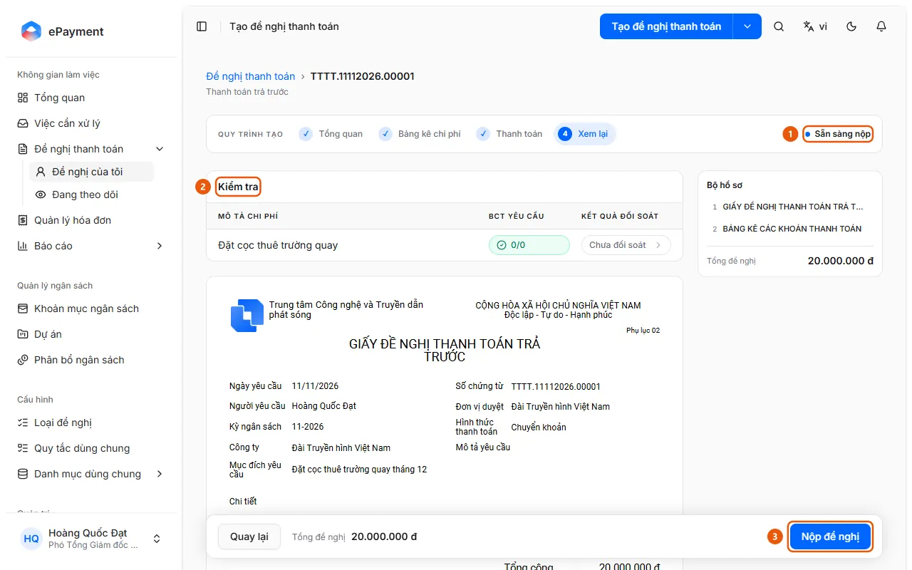

# Nộp đề nghị

Ở bước Xem lại bấm Nộp đề nghị; hệ thống mở bước duyệt đầu tiên và niêm phong phiếu.

## Trước khi bắt đầu

- **[Điều kiện để nộp đề nghị](../../../reference/requests/submission.md)**\
  Không nộp được nếu biểu mẫu chưa đủ, hóa đơn trùng, thiếu chứng từ bắt buộc, chưa đối soát xong, hoặc (ở mức Chặn) vượt ngân sách.

## Các bước

1. Mở đề nghị nháp ở bước **4 Xem lại** và kiểm tra trạng thái "Sẵn sàng nộp" (1) (nếu chưa đủ điều kiện, trang ghi "Vẫn còn điểm kiểm tra chưa được xử lý.").

   

2. Đọc mục **Kiểm tra** (2) và xử lý mọi điểm chặn như thiếu chứng từ bắt buộc ("Thiếu chứng từ bắt buộc: …"), chưa đối soát ("Chưa đối soát. Hãy đính kèm chứng từ và đối soát.") hoặc đang đối soát ("Đang đối soát. Hãy gửi khi đối soát xong.").
3. Bấm **Nộp đề nghị** (3).
4. Hệ thống kiểm tra lại điều kiện, gắn đề nghị với các hóa đơn lấy từ Quản lý hóa đơn, đặt hạn "Cam kết xong trước" theo lịch làm việc, mở bước duyệt đầu tiên, báo cho người duyệt và niêm phong phiếu thanh toán.
5. Trang hiện "Đã nộp đề nghị" và chuyển sang trang chi tiết đề nghị, nơi tải được bộ hồ sơ đã niêm phong. Nếu loại đề nghị có nhánh tự duyệt hoặc tự từ chối thì đề nghị có thể được duyệt hoặc từ chối ngay khi nộp.

## Xử lý lỗi

- Hiện "Không nộp được đề nghị" hoặc bị chặn: xem [Điều kiện để nộp đề nghị](../../../reference/requests/submission.md). Nộp lần hai bị từ chối vì đề nghị không còn là bản nháp.

## Điều kiện cần kiểm tra

- [Đề nghị nháp sẵn sàng nộp](../../../troubleshooting/requests/draft-ready.md) — Ở bước Xem lại, đề nghị hiện trạng thái "Sẵn sàng nộp" và không còn điểm kiểm tra nào chặn.

## Được dùng trong các hướng dẫn

- [Nộp đề nghị thanh toán để duyệt](../submit.md) — Người tạo đã điền xong và muốn nộp đề nghị cho người duyệt.
- [Chọn hóa đơn và tạo đề nghị thanh toán](../../invoices/how-to/create-request.md) — Tích các hóa đơn Sẵn sàng ở Quản lý hóa đơn, bấm Tạo ĐNTT, chọn Loại yêu cầu và bấm Tạo ĐNTT; mỗi hóa đơn thành một khoản chi trong bản nháp.
- [Tạo đề nghị và điền đến bước Xem lại](create-draft.md) — Sau khi mở đề nghị mới, thêm chi phí ở Bảng kê chi phí, điền thanh toán rồi đến bước Xem lại.
