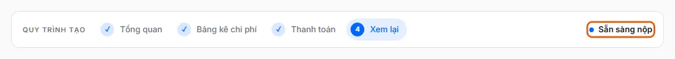
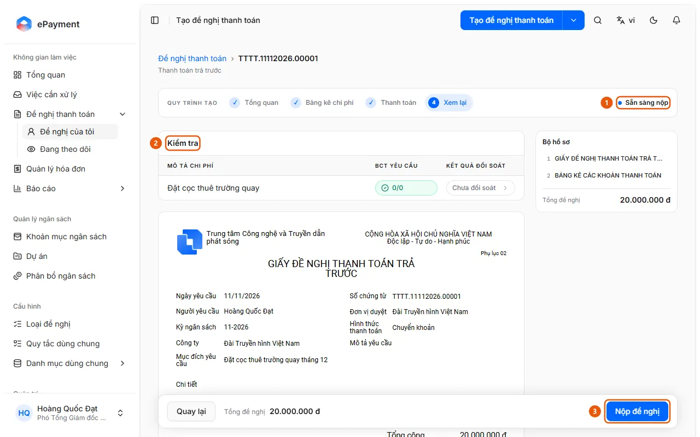

# Nộp đề nghị thanh toán để duyệt

Người tạo đã điền xong và muốn nộp đề nghị cho người duyệt.

**Khi nào sử dụng:** Người dùng soạn xong đề nghị và muốn nộp.

Đưa đề nghị từ bản nháp vào quy trình phê duyệt.

## Các cách thực hiện

- [Nộp đề nghị](how-to/submit.md) — Ở bước Xem lại bấm Nộp đề nghị; hệ thống mở bước duyệt đầu tiên và niêm phong phiếu.

## Được dùng trong các hướng dẫn

- [AkaPayment](../../overview.md) — Lập, duyệt và theo dõi đề nghị thanh toán; tiếp nhận hóa đơn đầu vào, đối soát chứng từ và quản lý ngân sách, có trợ lý AI.

## Trước khi bắt đầu

- **[Điều kiện để đi tiếp trong quy trình tạo đề nghị](../../reference/requests/draft-validation.md)** — chỉ khi [Đề nghị nháp sẵn sàng nộp](../../troubleshooting/requests/draft-ready.md) chưa được đáp ứng\
  Mỗi bước của quy trình tạo có trường bắt buộc; không đủ thì bấm Tiếp tục sẽ báo "Vui lòng sửa các trường được đánh dấu".
- **[Điều kiện để nộp đề nghị](../../reference/requests/submission.md)**\
  Không nộp được nếu biểu mẫu chưa đủ, hóa đơn trùng, thiếu chứng từ bắt buộc, chưa đối soát xong, hoặc (ở mức Chặn) vượt ngân sách.

## Các bước

[Nộp đề nghị](how-to/submit.md)

1. Kiểm tra [Đề nghị nháp sẵn sàng nộp](../../troubleshooting/requests/draft-ready.md).
   Mở đề nghị ở bước **Xem lại** (bước 4): nhãn góc phải thanh Quy trình tạo ghi "Sẵn sàng nộp" và nút "Nộp đề nghị" bấm được (không có dòng "Vẫn còn điểm kiểm tra chưa được xử lý.").
   
   Nếu chưa đáp ứng: làm theo [Tạo đề nghị và điền đến bước Xem lại](how-to/create-draft.md) bên dưới.
2. [Mở đề nghị mới và điền bước Tổng quan](how-to/start-draft.md) — chỉ khi [Đề nghị nháp sẵn sàng nộp](../../troubleshooting/requests/draft-ready.md) chưa được đáp ứng
   1. Bấm **Tạo đề nghị thanh toán** ở đầu trang (mở loại đề nghị mặc định); mũi tên bên cạnh mở danh sách các loại đề nghị đang bật để tìm và chọn (dữ liệu mẫu: Thanh toán, Tạm ứng, Hoàn ứng, Thanh toán trả trước, Thanh toán khác; danh sách thực tế do quản trị viên cấu hình). Một bản nháp được tạo ngay.
      
   2. Ở bước **1 Tổng quan**, nhập **Mục đích yêu cầu** (2); kiểm tra **Người yêu cầu** (là bạn), **Đơn vị duyệt** (đơn vị của bạn), **Đối tượng thanh toán** (đã điền sẵn) và các trường khác như Ngày yêu cầu, Số chứng từ, Công ty, Kỳ ngân sách, Thời hạn thanh toán, Mô tả yêu cầu. Đơn vị duyệt cũng là Bộ phận chịu chi phí mặc định của các dòng chi phí.
      
   3. Bấm **Tiếp tục** (3) để sang bước **2 Bảng kê chi phí**.
3. [Tạo đề nghị và điền đến bước Xem lại](how-to/create-draft.md) — chỉ khi [Đề nghị nháp sẵn sàng nộp](../../troubleshooting/requests/draft-ready.md) chưa được đáp ứng
   1. Ở bước **2 Bảng kê chi phí**, bấm **Thêm chi phí** để thêm dòng thủ công, hoặc mũi tên bên cạnh: [Thêm chi phí từ hóa đơn](how-to/add-invoice-expense.md), [Nhập bộ chứng từ thành các dòng chi phí](how-to/import-bundle.md), [Áp dụng phân bổ cho tất cả chi phí](how-to/apply-expense-defaults.md). Có thể đính kèm cho cả đề nghị bằng [Đính kèm chứng từ chung cho cả đề nghị](how-to/add-shared-documents.md).
      
   2. Với dòng thêm thủ công, nhập **Mô tả chi phí** và **Tổng tiền**; mở dòng để kiểm tra mục **Phân bổ**: **Khoản mục ngân sách** (điền sẵn theo dòng đầu tiên hoặc khoản mục đang hoạt động đầu tiên), **Bộ phận chịu chi phí** (điền sẵn theo Đơn vị duyệt), **Dự án chịu chi phí** (chỉ khi ngân sách quản lý theo dự án), Cán bộ nhân viên. Đính kèm hóa đơn bằng **Đính kèm hóa đơn**.
   3. Bấm **Tiếp tục**. Bản nháp tự lưu khi bạn sửa (nhãn "Đang lưu..." rồi "Đã lưu" cạnh tên loại đề nghị).
   4. Ở bước **3 Thanh toán**, chọn **Hình thức thanh toán** (4) trong các hình thức loại đề nghị cho phép (Chuyển khoản, Tiền mặt, Bù trừ công nợ; mặc định Chuyển khoản).
      
   5. Điền bảng **Người thụ hưởng**: bấm **Điền theo bảng kê** (5) để tạo sẵn một dòng cho mỗi bên nhận từ các chi phí, hoặc **Thêm người thụ hưởng**; biểu tượng sách ở đầu dòng chọn tài khoản đã lưu trong danh bạ thanh toán. Chuyển khoản cần Số tài khoản, Tên người nhận, Tên ngân hàng và Số tiền; Tiền mặt và Bù trừ công nợ cần Tên người nhận, Số CMND/CCCD và Số tiền.
   6. Kiểm tra **Tổng người thụ hưởng** bằng **Tổng chi phí** rồi bấm **Tiếp tục** (6).
   7. Ở bước **4 Xem lại** (nhãn "Sẵn sàng nộp"), đọc mục **Kiểm tra** (từng chi phí và chứng từ bắt buộc), bản xem trước "Giấy đề nghị thanh toán" và **Bộ hồ sơ**; nếu loại đề nghị có đối soát, bước này tự đối soát các chi phí có tệp mà chưa đối soát hoặc đã đổi. Có thể **Tạo bảng kê** hoặc **Tải lên bản đã sửa** nếu loại đề nghị dùng bảng kê Excel. Nộp đề nghị ở [Nộp đề nghị](how-to/submit.md).
4. [Nộp đề nghị](how-to/submit.md)
   1. Mở đề nghị nháp ở bước **4 Xem lại** và kiểm tra trạng thái "Sẵn sàng nộp" (1) (nếu chưa đủ điều kiện, trang ghi "Vẫn còn điểm kiểm tra chưa được xử lý.").
      
   2. Đọc mục **Kiểm tra** (2) và xử lý mọi điểm chặn như thiếu chứng từ bắt buộc ("Thiếu chứng từ bắt buộc: …"), chưa đối soát ("Chưa đối soát. Hãy đính kèm chứng từ và đối soát.") hoặc đang đối soát ("Đang đối soát. Hãy gửi khi đối soát xong.").
   3. Bấm **Nộp đề nghị** (3).
   4. Hệ thống kiểm tra lại điều kiện, gắn đề nghị với các hóa đơn lấy từ Quản lý hóa đơn, đặt hạn "Cam kết xong trước" theo lịch làm việc, mở bước duyệt đầu tiên, báo cho người duyệt và niêm phong phiếu thanh toán.
   5. Trang hiện "Đã nộp đề nghị" và chuyển sang trang chi tiết đề nghị, nơi tải được bộ hồ sơ đã niêm phong. Nếu loại đề nghị có nhánh tự duyệt hoặc tự từ chối thì đề nghị có thể được duyệt hoặc từ chối ngay khi nộp.

## Nếu có sự cố

### [Tạo đề nghị và điền đến bước Xem lại](how-to/create-draft.md)

- Báo "Vui lòng sửa các trường được đánh dấu trước khi tiếp tục": xem [Điều kiện để đi tiếp trong quy trình tạo đề nghị](../../reference/requests/draft-validation.md).
- Dòng báo "Hóa đơn này đã có ở dòng …": một hóa đơn chỉ được thanh toán một lần; gỡ hóa đơn trùng.

### [Nộp đề nghị](how-to/submit.md)

- Hiện "Không nộp được đề nghị" hoặc bị chặn: xem [Điều kiện để nộp đề nghị](../../reference/requests/submission.md). Nộp lần hai bị từ chối vì đề nghị không còn là bản nháp.
