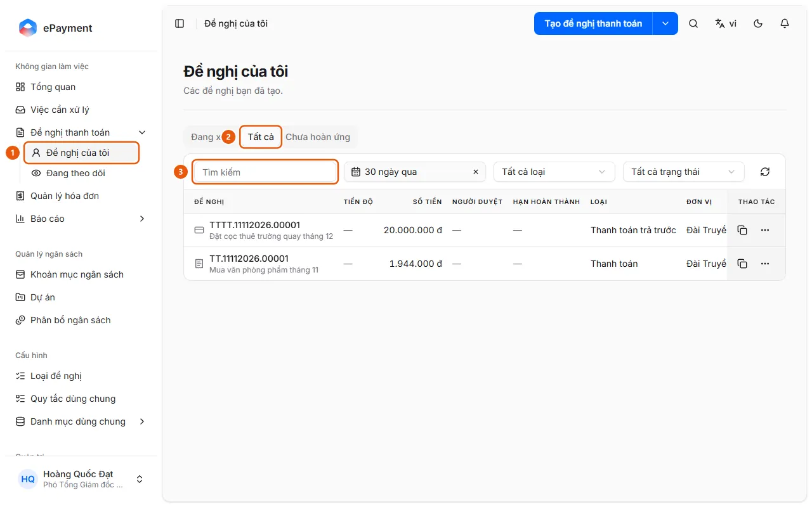

# Tìm một đề nghị

Người dùng muốn tìm lại một đề nghị và xem tiến độ duyệt.

**Khi nào sử dụng:**

- Người dùng muốn biết đề nghị đã gửi đang ở bước nào.
- Người dùng muốn tra cứu một đề nghị do mình tạo.

Tra cứu đề nghị đã tạo theo từ khóa, loại hoặc thời gian.

## Các cách thực hiện

- [Tìm đề nghị](how-to/find-request.md) — Mở Đề nghị của tôi và dùng tab, tìm kiếm, bộ lọc; hoặc dùng tìm kiếm toàn cục Ctrl+K.

## Được dùng trong các hướng dẫn

- [AkaPayment](../../overview.md) — Lập, duyệt và theo dõi đề nghị thanh toán; tiếp nhận hóa đơn đầu vào, đối soát chứng từ và quản lý ngân sách, có trợ lý AI.

## Các bước

[Tìm đề nghị](how-to/find-request.md)

1. [Tìm đề nghị](how-to/find-request.md)
   1. Ở thanh bên mở **Đề nghị thanh toán** → **Đề nghị của tôi** (1) (các đề nghị bạn đã tạo).
      
   2. Chọn tab **Đang xử lý**, **Tất cả** (2) hoặc **Chưa hoàn ứng** (các khoản tạm ứng chưa hoàn ứng, với số tiền tạm ứng, đã hoàn và còn lại).
   3. Gõ vào ô **Tìm kiếm** (3) hoặc dùng các bộ lọc thời gian (tab **Tất cả** mặc định "30 ngày qua", tab **Đang xử lý** "Mọi thời điểm"), **Tất cả loại** và, ở tab **Tất cả**, **Tất cả trạng thái**.
   4. Hoặc bấm biểu tượng tìm kiếm ở đầu trang (Ctrl+K) và gõ từ khóa: kết quả gồm nhóm "Đề nghị" và "Việc cần làm của bạn"; gõ # và mã để tìm đề nghị đã kết thúc quá 365 ngày.
   5. Bấm vào kết quả để mở chi tiết đề nghị (Tiến độ, Hồ sơ, Trao đổi, Lịch sử). Để xem đề nghị của đơn vị bạn, mở **Đề nghị thanh toán** → **Đang theo dõi** (trang "Theo dõi") → tab **Đơn vị**; tab **Được nhắc đến** liệt kê đề nghị có người nhắc tên bạn.
