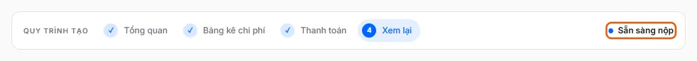

# Đề nghị nháp sẵn sàng nộp

Ở bước Xem lại, đề nghị hiện trạng thái "Sẵn sàng nộp" và không còn điểm kiểm tra nào chặn.

**Kiểm tra:** Mở đề nghị ở bước **Xem lại** (bước 4): nhãn góc phải thanh Quy trình tạo ghi "Sẵn sàng nộp" và nút "Nộp đề nghị" bấm được (không có dòng "Vẫn còn điểm kiểm tra chưa được xử lý.").

Mọi bước đã hợp lệ: có chi phí, người thụ hưởng khớp tổng chi phí, đủ chứng từ bắt buộc và (nếu loại đề nghị đối soát) đã đối soát xong.

## Cách khắc phục

- [Tạo đề nghị và điền đến bước Xem lại](../../guides/requests/how-to/create-draft.md) — Sau khi mở đề nghị mới, thêm chi phí ở Bảng kê chi phí, điền thanh toán rồi đến bước Xem lại.

## Được dùng trong các hướng dẫn

- [Tạo đề nghị và điền đến bước Xem lại](../../guides/requests/how-to/create-draft.md) — Sau khi mở đề nghị mới, thêm chi phí ở Bảng kê chi phí, điền thanh toán rồi đến bước Xem lại.
- [Nộp đề nghị](../../guides/requests/how-to/submit.md) — Ở bước Xem lại bấm Nộp đề nghị; hệ thống mở bước duyệt đầu tiên và niêm phong phiếu.
